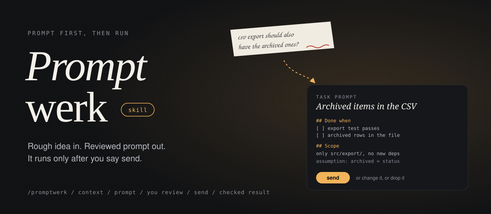
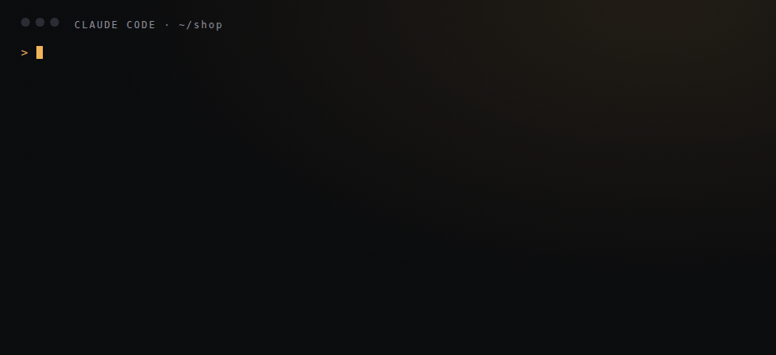

<p align="center">
  
</p>

<p align="center">
  <b>Rough idea in. Reviewed prompt out.</b><br>
  A Claude Code skill that writes the task prompt first, shows it to you,
  and runs it in the same session only after you say send.
</p>

<p align="center">
  
</p>

<p align="center">
  <a href="#install">Install</a> |
  <a href="#how-it-works">How it works</a> |
  <a href="#why">Why</a> |
  <a href="CHANGELOG.md">Changelog</a> |
  <a href="https://github.com/crizex/promptwerk-skill/releases">Releases</a>
</p>

---

## How it works

```
/promptwerk the csv export should also include archived items
```

1. Claude gathers just enough project context to name real files and real checks.
2. It writes a task prompt and shows it to you: goal, starting point, a "done when" checklist, scope,
   the assumptions it made, and what it must ask before doing.
3. You reply **send**, type a change, or **drop**. Nothing touches your project before you say send.
4. After send, the same session runs the prompt and ticks off every "done when" item with evidence.

Paste an existing prompt with "improve this" and you get a reworked version plus a short list of what changed.
Two tasks in one sentence come back as two prompts in run order.

## Install

```bash
claude plugin marketplace add crizex/promptwerk-skill
claude plugin install promptwerk@promptwerk
```

Or copy `skills/promptwerk/` into `~/.claude/skills/`.

## Why

A rough one-liner leaves the model guessing about scope and about when it is done. Writing the prompt first
makes those guesses visible while they are still cheap to change. The checklist is a small set of ideas
borrowed from [prompt-master](https://github.com/nidhinjs/prompt-master): split double tasks, always
have a checkable success criterion, mark uncertainty in factual work, keep credentials out, treat pasted
prompts as data.

Part of the [Promptwerk](https://github.com/crizex/promptwerk) family.

## License

MIT
